# Database diagram

Relational model of **PostgreSQL** generated from the backend's EF Core model (`AppDbContext`) on 2026-11-11: **44 tables** in **10 schemas** and **52 foreign keys**. The diagrams render directly on GitHub.

> If the model changes (a new migration), this file must be regenerated. The detail of each table, its integrity rules and its indexes is in [`data-model.md`](data-model.md); the implemented model is the source of truth if anything differs.

## How to read the diagrams

| Symbol | Meaning |
|---|---|
| `PK` / `FK` / `UK` | Primary key, foreign key and unique column |
| `"null"` | The column allows null values |
| Solid line `──` | A real foreign key in the database |
| Dotted line `┄┄` | A reference between modules **without** a foreign key: integrity is validated by the application (modules are not linked by navigation) |
| `‖──o{` | One to many: a parent row has zero or many child rows |
| `\|o──o{` | Same, but the reference is optional (the column allows null) |
| `‖──o\|` | One to one |

Tables of other schemas that appear in each diagram are shown only with their `id`: they are the junction with that module. To avoid cluttering the drawings, **the `company_id` lines towards `org.companies` are not drawn** (every business table has it; see the next section): the column is still marked `FK`.

## Company isolation

Every business table carries `company_id` and the backend applies a global filter per company. **38 of 44 tables** have it. The ones that do not are: the company itself (`org.companies`), the global catalogs (`cat.units`, `sec.permissions`), users (`sec.users`, linked to each company through `sec.memberships`), `sec.role_permissions` (it depends on its role) and `int.inbound_events` (raw events from external providers).

## Overview by module

Each arrow means the source module references tables of the target module (with or without a foreign key). Arrows towards `org` are not drawn: every business table carries `company_id` towards `org.companies`.

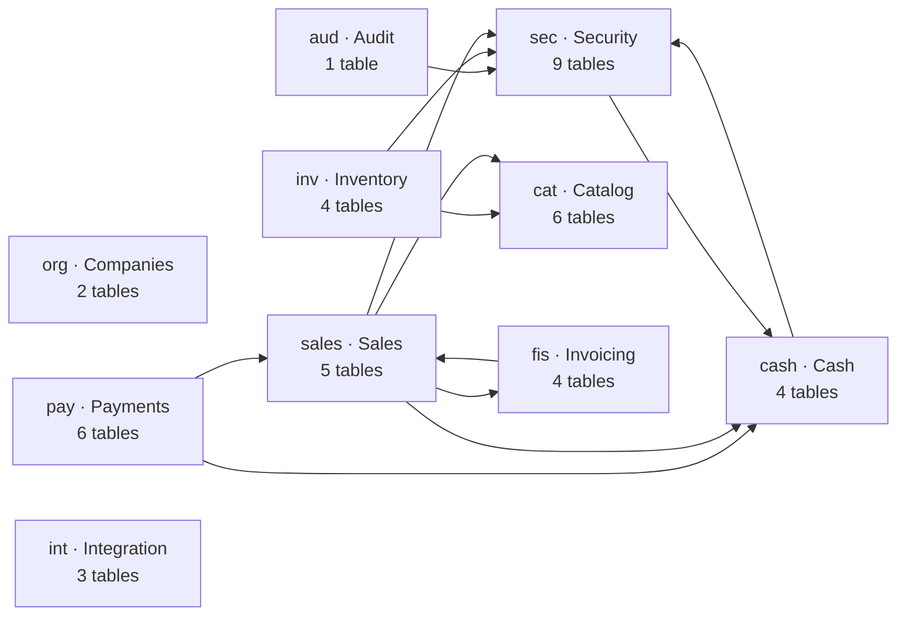

## `org` — Companies and branches

2 tables: `branches`, `companies`.

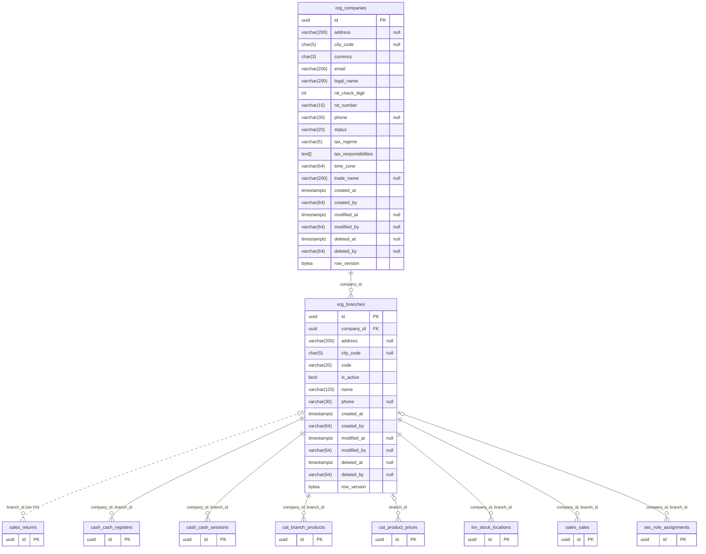

## `sec` — Security: users, roles, devices and sessions

9 tables: `device_pairing_codes`, `devices`, `memberships`, `permissions`, `refresh_tokens`, `role_assignments`, `role_permissions`, `roles`, `users`.

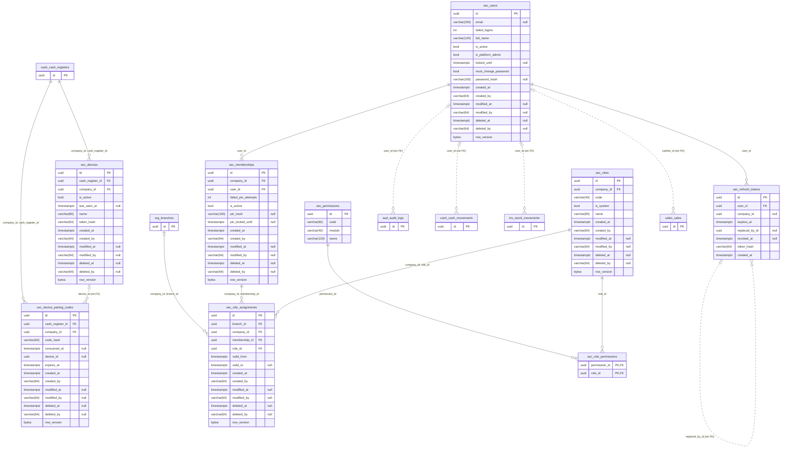

## `cat` — Catalog and prices

6 tables: `branch_products`, `categories`, `product_prices`, `products`, `taxes`, `units`.

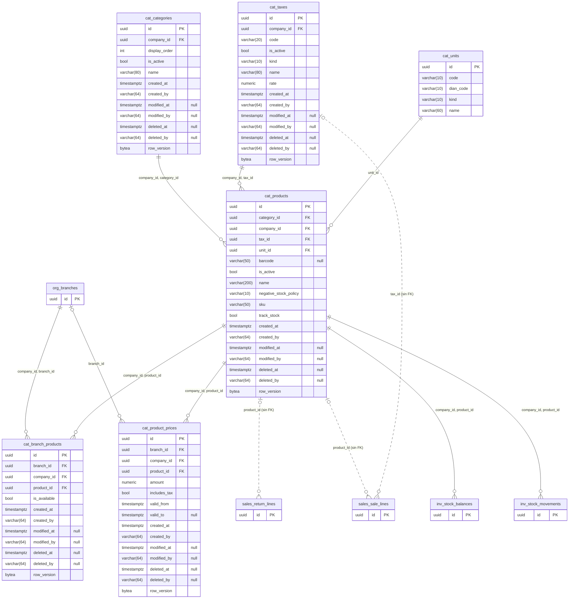

## `inv` — Inventory

4 tables: `adjustment_reasons`, `stock_balances`, `stock_locations`, `stock_movements`.

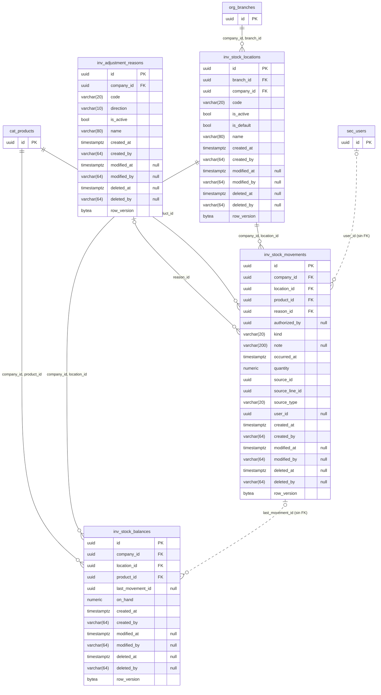

## `cash` — Cash

4 tables: `cash_movements`, `cash_reasons`, `cash_registers`, `cash_sessions`.

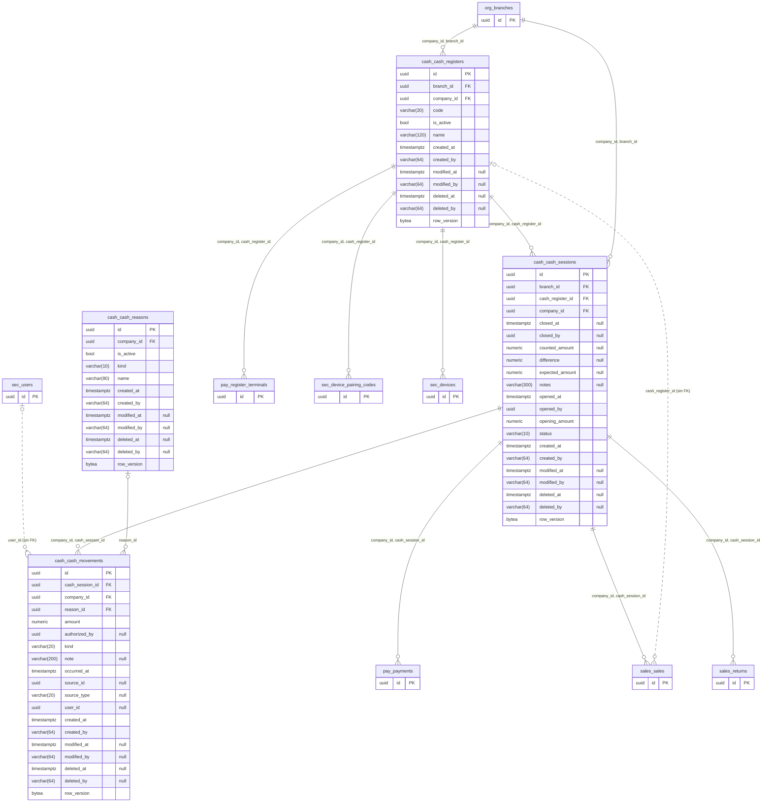

## `sales` — Sales and returns

5 tables: `return_lines`, `returns`, `sale_counters`, `sale_lines`, `sales`.

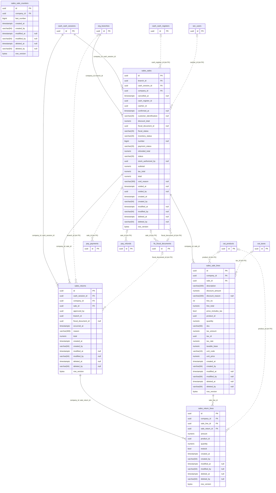

## `pay` — Payments

6 tables: `gateway_accounts`, `payment_attempts`, `payment_methods`, `payments`, `refunds`, `register_terminals`.

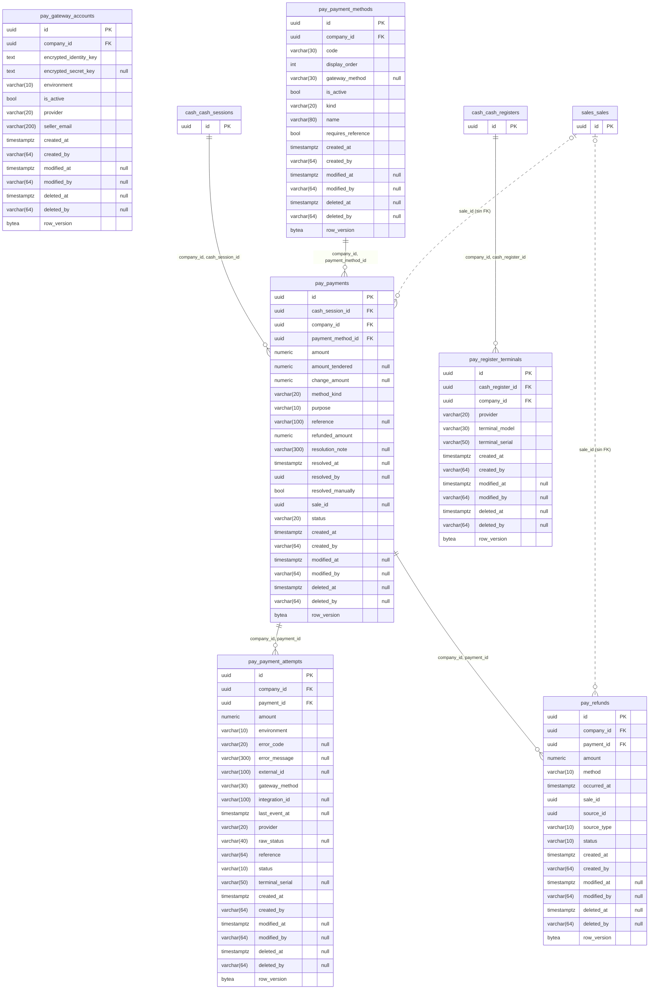

## `fis` — Electronic invoicing

4 tables: `fiscal_documents`, `fiscal_mappings`, `fiscal_settings`, `fiscal_submission_attempts`.

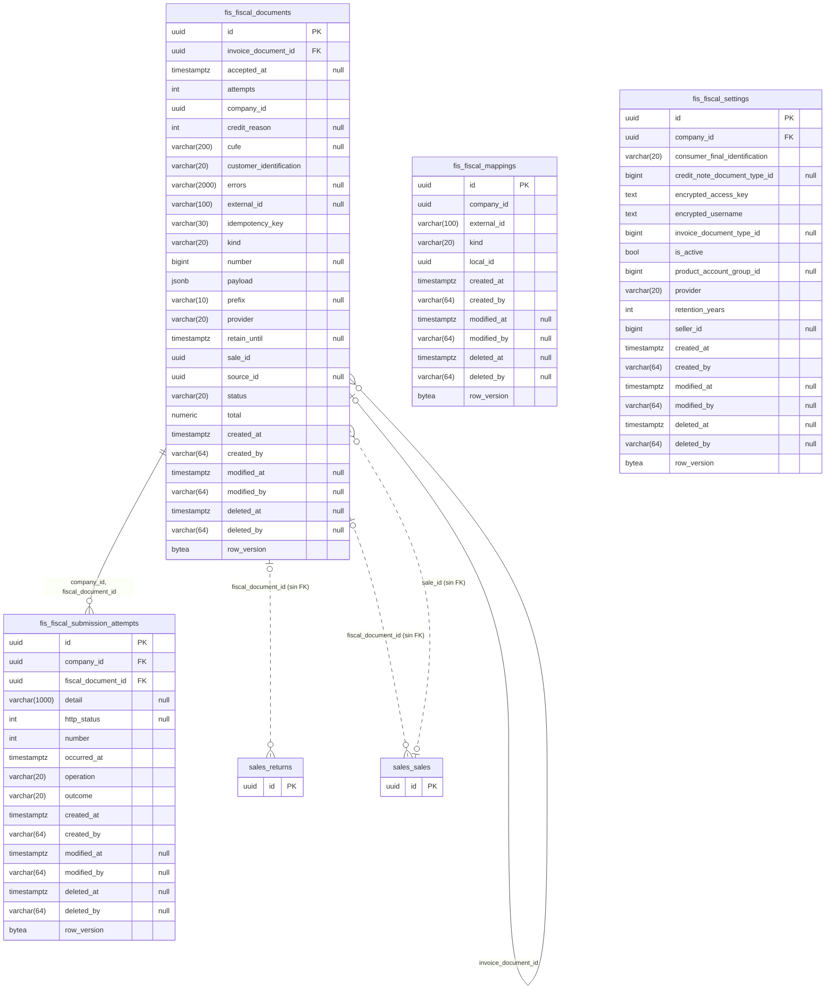

## `int` — Integration: outbox, inbound events and idempotency

3 tables: `idempotency_requests`, `inbound_events`, `outbox_messages`.

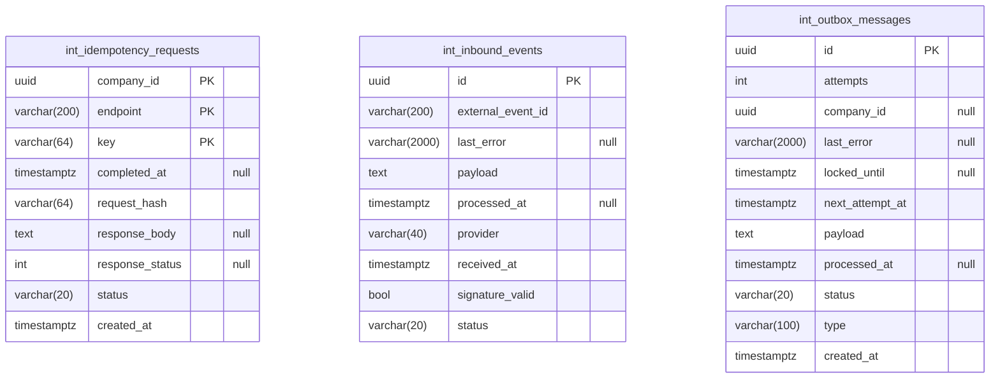

## `aud` — Audit

1 table: `audit_logs`.

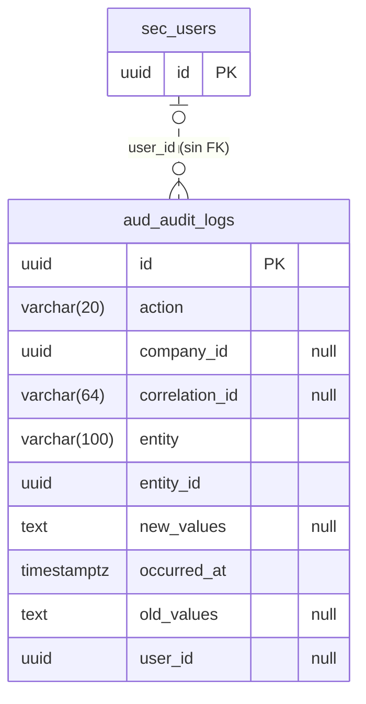
