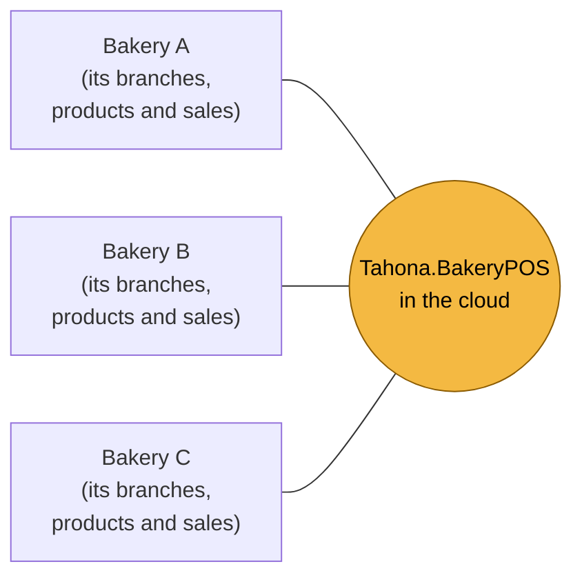
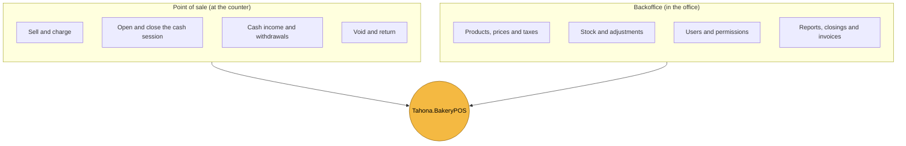
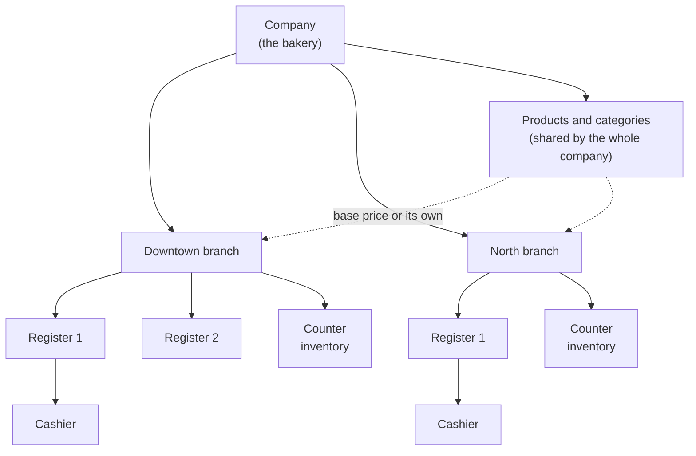
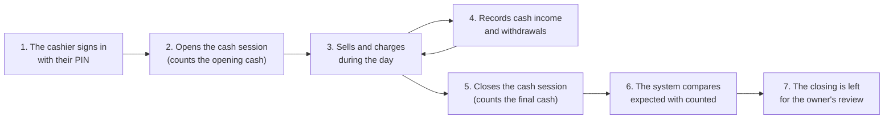
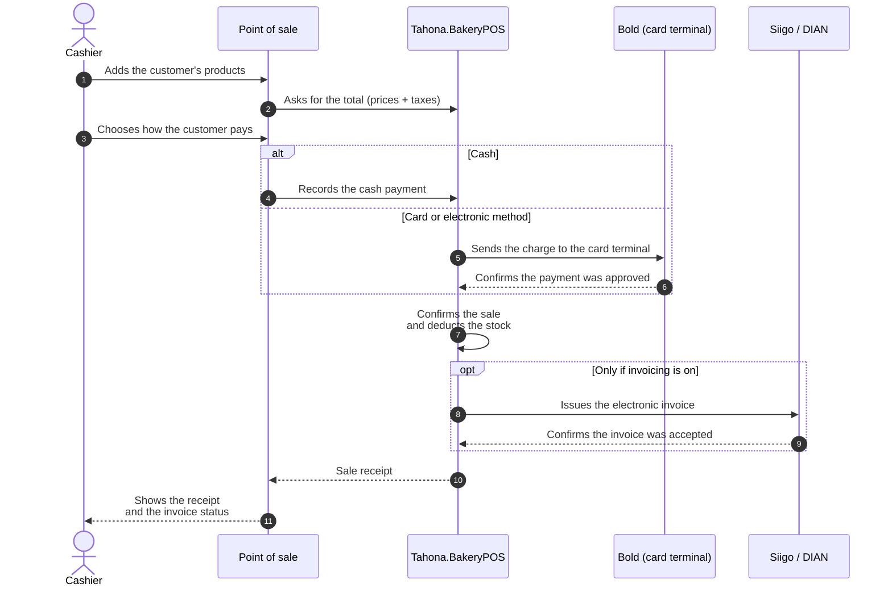
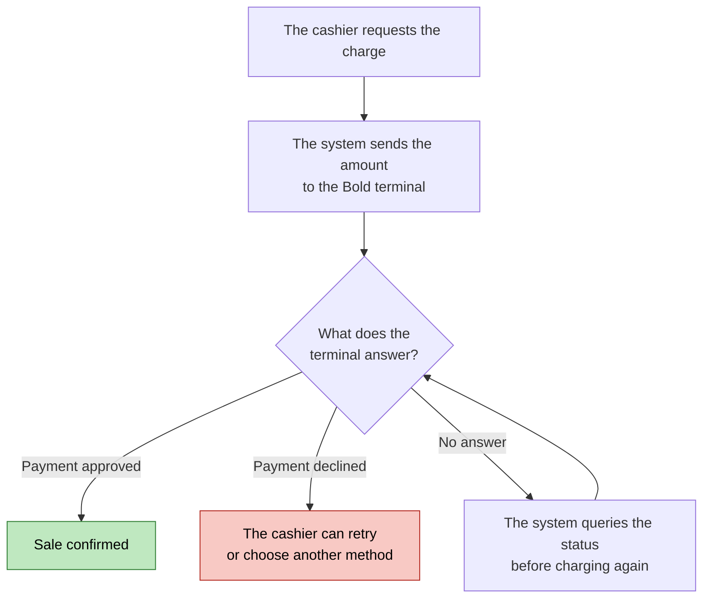
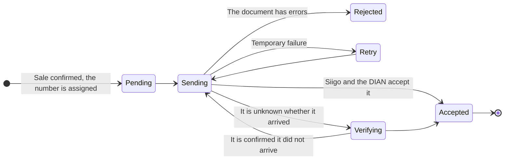
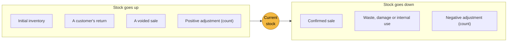
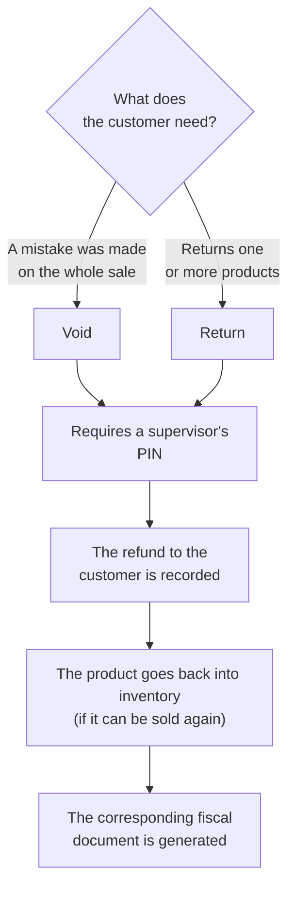
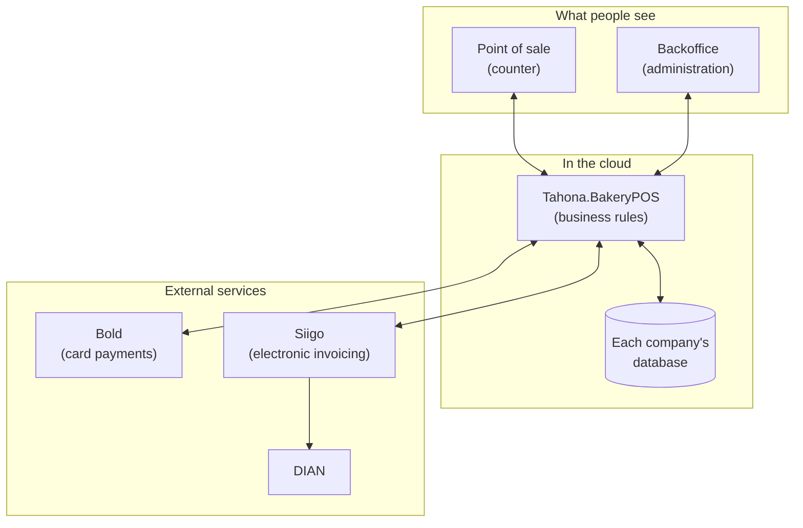

# Tahona.BakeryPOS general guide

This guide explains, without technical language, what Tahona.BakeryPOS is, who uses it and how a bakery's day-to-day
works with the system. The diagrams render directly on GitHub.

---

## 1. What is it?

Tahona.BakeryPOS is a **cloud point-of-sale system for bakeries in Colombia**. It replaces the cash
register and the account notebook: it lets you sell, charge, keep track of stock, close the cash session and issue the electronic
invoice, all in one place and from any tablet or computer with internet.

One platform serves **many companies**. Each company only sees its own information; nobody can see another
company's data.

> Each bakery is a world of its own: one bakery's information is never mixed with another's.

---

## 2. Who uses it?

| Person | What they do in the system |
|---|---|
| **Platform administrator** | Onboards new bakeries. Does not see the companies' sales. |
| **Owner** | The bakery's owner. Configures branches, products, prices, users, payments and invoicing. Authorizes voids, returns and stock adjustments. |
| **Branch administrator** | Manages their branch: local prices, stock, cash registers and queries. |
| **Cashier** | Opens and closes the cash session, sells, charges and records cash income or withdrawals. |

And two external services the system connects to:

| Service | What it is for |
|---|---|
| **Bold** (card terminal) | Charging by card and other electronic methods. |
| **Siigo** (invoicing provider) | Issuing the electronic invoice and sending it to the DIAN. |

---

## 3. The two screens of the system

The system has two parts that are used in different places:

- The **point of sale** is the cashier's screen: large, fast and designed for a tablet or computer.
- The **backoffice** is the owner's or administrator's screen: this is where the business is configured and reports are consulted.

Each person only sees the options their role allows.

> The system **needs an internet connection** to work.

---

## 4. How a company is organized

- A **company** has one or several **branches**.
- Each branch has its **cash registers** and its own **inventory**.
- **Products** are created once and shared. Each branch can use the base price or its own.
- Each **physical register** is paired to a device (tablet or computer) once; after that the cashier signs in with their **PIN**.

---

## 5. A day at the bakery

What matters about the cash close:

- The system **calculates how much cash there should be** (opening cash + cash sales + income − withdrawals).
- The cashier counts what is really there and the system shows the **difference**.
- **The cash session cannot be closed** if an electronic payment is still pending confirmation.

---

## 6. The sale, step by step

Four things are tracked **separately**, because each can take long or fail in a different way:

| What is tracked | Example states |
|---|---|
| **The sale** | in progress · confirmed · voided |
| **The payment** | pending · approved · declined |
| **The inventory** | deducted · returned |
| **The electronic invoice** | no invoice · pending · sent · accepted · rejected |

So, for example, a sale can be confirmed while its invoice is still being sent, without the cashier having to
wait.

---

## 7. Card payment

Card payment is where the most care is taken, because it involves real money.

Rules that protect the business and the customer:

- **A payment is only accepted as good when Bold confirms it to the system.** What the cashier's screen shows is not enough.
- If the connection drops in the middle of a charge, the system **first checks** what happened. That avoids charging twice.
- If the confirmed amount does not match the amount charged, the payment is marked as an error and an alert is raised.
- The keys of the Bold account are stored **encrypted** and are never shown.

---

## 8. The electronic invoice

Electronic invoicing is **optional and is turned on or off per company**, from the backoffice (`Configuración →
Facturación electrónica`).

| Switch | What happens with each sale |
|---|---|
| **On** | Its electronic invoice is generated automatically. The system sends it to **Siigo**, which validates it and transmits it to the **DIAN**. |
| **Off** | The sale is recorded normally and marked as "no invoice". |

Turning it off does not affect Bold payments, inventory or the cash session. And if there were invoices in progress, **they are still sent**.

> If your company is obliged by the DIAN to invoice electronically, check with your accountant before turning it off: the system
> does not validate it.

When it is on, each invoice goes through these states:

Important rules:

- An invoice is **only considered accepted when Siigo confirms it**.
- If it is not known whether an invoice arrived, the system **first queries** and then resends with the **same number**, never a
  new one. That way invoices are not duplicated and consecutive numbers are not lost.
- Numbers are taken from the **numbering authorized** by the DIAN. The system warns the owner when the range is
  about to run out or expire.
- If an invoice is rejected, it stays visible to the owner with the reason.

---

## 9. Inventory (stock)

Inventory works like a **notebook of entries and exits that cannot be erased or crossed out**.

- Stock is **never edited directly**. Every change is left as a movement with a date, a person and a reason.
- **Waste** (the day's bread that was not sold) is recorded as an adjustment with the "Merma" reason.
- A **physical count** can be made and the system shows the differences so they can be adjusted.

**What happens if something is sold that shows no stock?** Each product has its rule:

| Product rule | What happens when selling without stock |
|---|---|
| **Allow** | The sale goes ahead. Useful for bread that is baked and sold before production is recorded. |
| **Block** | The sale stops until the owner authorizes it with their PIN. It is recorded. |

---

## 10. Voids and returns

These operations **always require authorization** and are recorded with who did them and when.

---

## 11. Security and order

| Question | Answer |
|---|---|
| Can other bakeries see my data? | **No.** Each company is isolated and the system is tested to guarantee it. |
| Who can do what? | Each user has a **role** with permissions. They only see and do what their role allows. |
| How does the cashier sign in? | With a **PIN** on a previously paired register. The PIN is stored encrypted. |
| Is it known who changed what? | **Yes.** Every important change is left in an audit trail with the before and the after. |
| And the Bold and Siigo keys? | They are stored **encrypted** and are never shown on screen or in the logs. |
| Can one person work for two companies? | Yes, with the same email (for example, an accountant). On signing in they choose the company. |

---

## 12. How it all fits together

The system separates the "brain" from the screens: the business rules, the database and the connection with Bold and Siigo
are published as an **API**, and the screens (point of sale and backoffice) are clients that consume it. The API works,
is tested and is deployed on its own, without depending on any screen.

---

## 13. Frequently asked questions

**What happens if the internet goes down?**
The system works online, so it needs a connection to sell. If it drops in the middle of a card payment, once the
connection returns the system checks what happened before allowing another charge.

**Can a customer be charged twice by mistake?**
The system is designed to prevent it: each charge has a unique identification and, when in doubt, it is queried before
retrying.

**Is it mandatory to invoice electronically in the system?**
No. It is a per-company option that the owner turns on or off. Bold payments work the same with it off.

**Can invoice numbers be lost?**
No. Numbers are assigned in order from the authorized numbering and are not reused.

**Who can void a sale?**
Only whoever has the permission, with the authorization of a supervisor or the owner, and it is recorded.

**Can I have different prices per branch?**
Yes. Each product has a base price and each branch can define its own, with a start and end date.

**Where do I see how much was sold?**
In the backoffice: sales, the sales report, cash closings and the dashboard.

---

## 14. Glossary

| Term | Meaning |
|---|---|
| **POS** | Point of sale: the screen used to sell at the counter. |
| **Backoffice** | The business's administration screen. |
| **Branch** | A bakery location. |
| **Cash register** | A payment station within a branch. |
| **Shift / cash session** | The period between the cashier opening and closing the cash session. |
| **PIN** | The cashier's short code to sign in to the register. |
| **Card terminal** | Equipment used to charge by card. |
| **Waste (merma)** | Product that is lost or not sold (for example, the previous day's bread). |
| **Stock** | The quantity of each product available. |
| **DIAN** | The entity that regulates electronic invoicing in Colombia. |
| **Electronic invoice** | A digital invoice validated by the DIAN. |
| **Numbering** | Range of invoice numbers authorized by the DIAN. |
| **Audit** | Record of who made what change and when. |

---

If you need the technical detail of any topic, it is in this same folder: [`architecture.md`](architecture.md),
[`payment-integration.md`](payment-integration.md), [`electronic-invoicing.md`](electronic-invoicing.md) and
[`inventory.md`](inventory.md).
