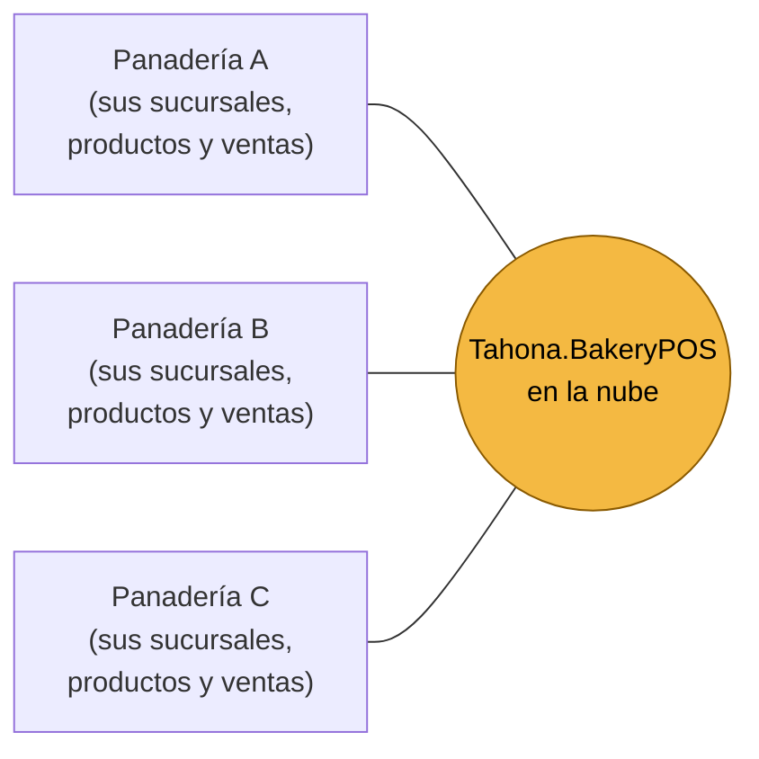
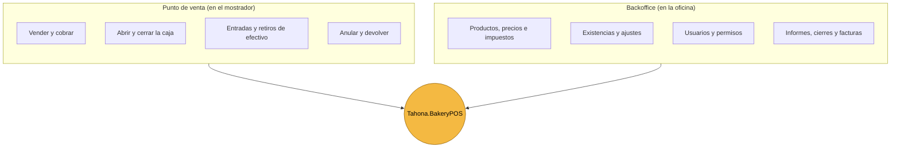
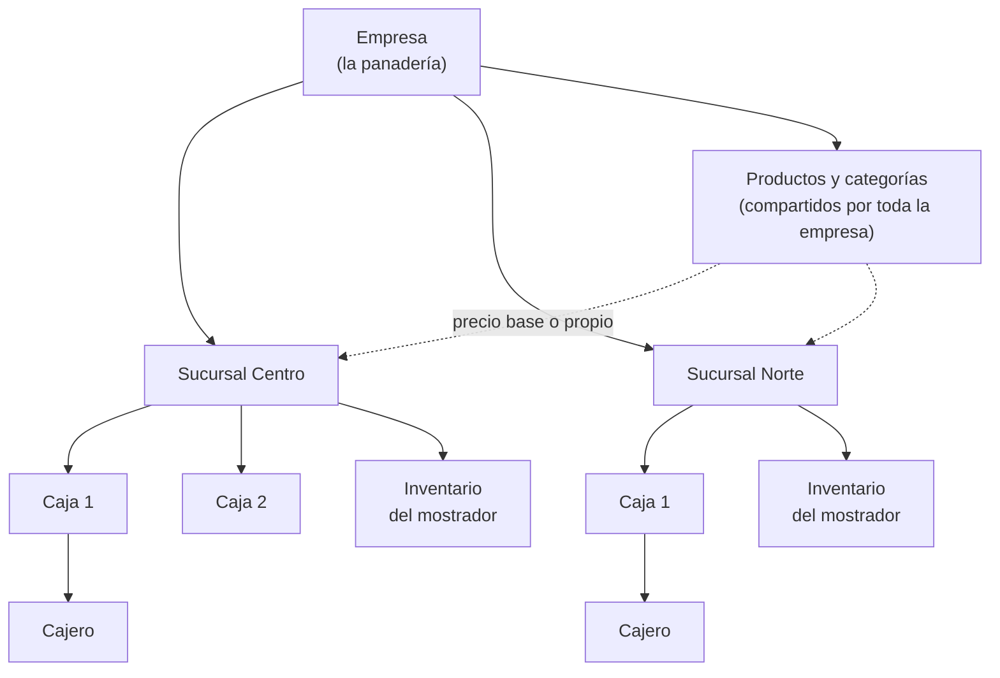
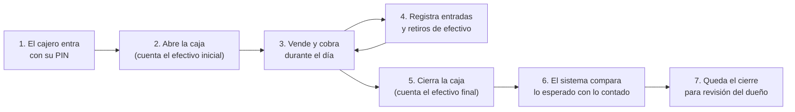
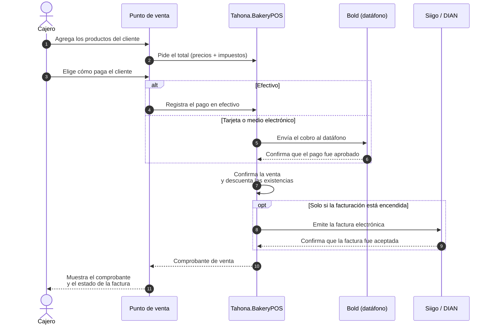
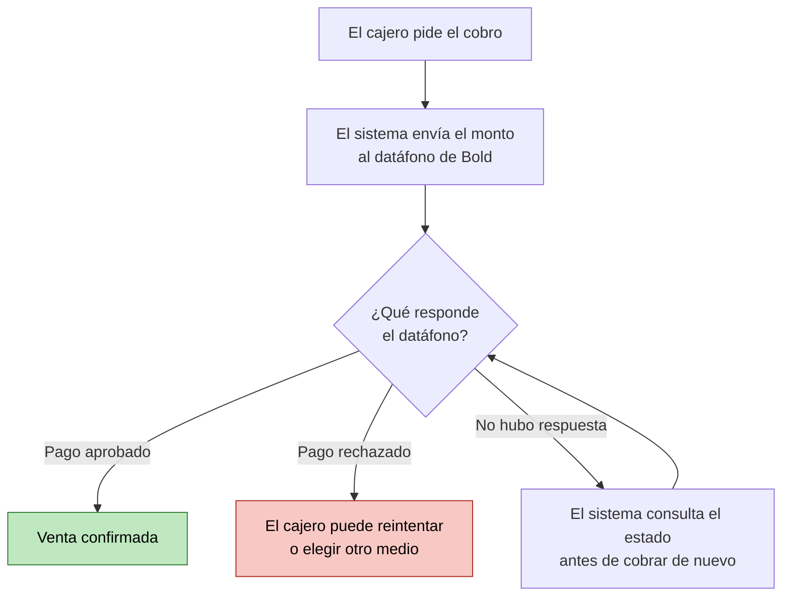
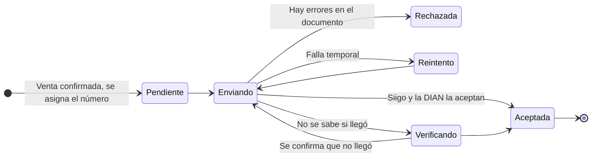
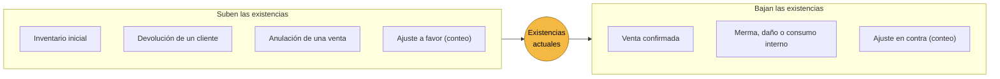
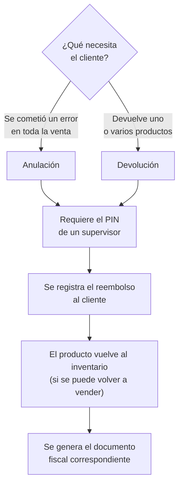
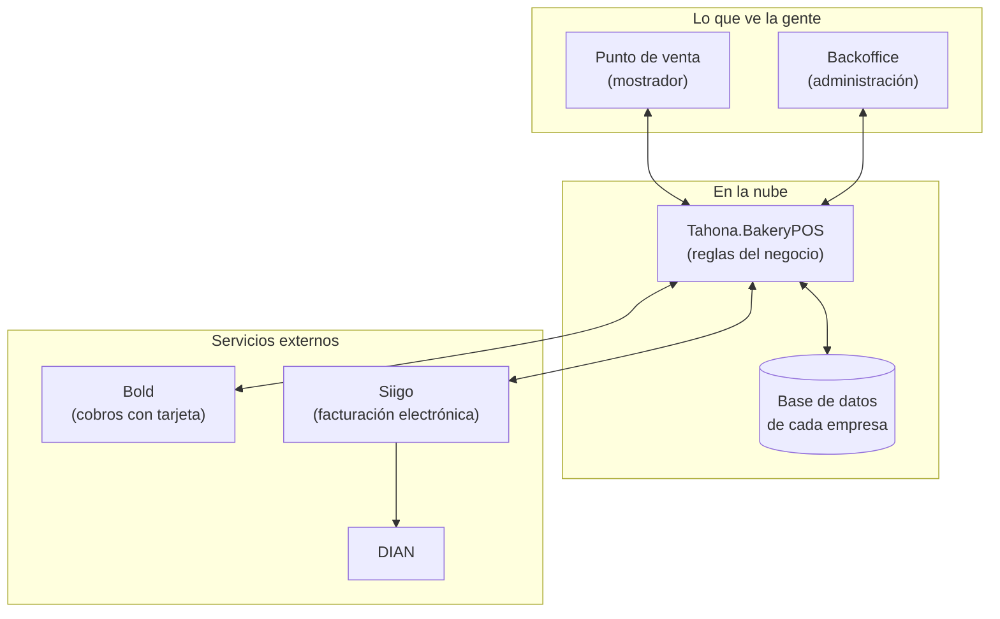

# Guía general de Tahona.BakeryPOS

Esta guía explica, sin lenguaje técnico, qué es Tahona.BakeryPOS, quién lo usa y cómo funciona el día a día de una
panadería con el sistema. Los diagramas se ven directamente en GitHub.

---

## 1. ¿Qué es?

Tahona.BakeryPOS es un **sistema de punto de venta en la nube para panaderías en Colombia**. Reemplaza la caja
registradora y el cuaderno de cuentas: permite vender, cobrar, llevar las existencias, cerrar la caja y emitir la factura
electrónica, todo desde un solo lugar y desde cualquier tablet o computador con internet.

Una misma plataforma atiende a **muchas empresas**. Cada empresa solo ve su propia información; nadie puede ver los datos
de otra.

> Cada panadería es un mundo aparte: la información de una nunca se mezcla con la de otra.

---

## 2. ¿Quién lo usa?

| Persona | Qué hace en el sistema |
|---|---|
| **Administrador de la plataforma** | Da de alta a las panaderías nuevas. No ve las ventas de las empresas. |
| **Propietario** | Es el dueño de la panadería. Configura sucursales, productos, precios, usuarios, pagos y facturación. Autoriza anulaciones, devoluciones y ajustes de existencias. |
| **Administrador de sucursal** | Gestiona su sucursal: precios locales, existencias, cajas y consultas. |
| **Cajero** | Abre y cierra la caja, vende, cobra y registra entradas o retiros de efectivo. |

Y dos servicios externos con los que el sistema se conecta:

| Servicio | Para qué sirve |
|---|---|
| **Bold** (datáfono) | Cobrar con tarjeta y otros medios electrónicos. |
| **Siigo** (proveedor de facturación) | Emitir la factura electrónica y enviarla a la DIAN. |

---

## 3. Las dos pantallas del sistema

El sistema tiene dos partes que se usan en lugares distintos:

- El **punto de venta** es la pantalla del cajero: grande, rápida y pensada para tablet o computador.
- El **backoffice** es la pantalla del dueño o del administrador: aquí se configura el negocio y se consultan los informes.

Cada persona solo ve las opciones que su rol le permite.

> El sistema **necesita conexión a internet** para funcionar.

---

## 4. Cómo se organiza una empresa

- Una **empresa** tiene una o varias **sucursales**.
- Cada sucursal tiene sus **cajas** y su propio **inventario**.
- Los **productos** se crean una sola vez y se comparten. Cada sucursal puede usar el precio base o uno propio.
- Cada **caja física** se vincula a un equipo (tablet o computador) una sola vez; después el cajero entra con su **PIN**.

---

## 5. Un día en la panadería

Lo importante del cierre de caja:

- El sistema **calcula cuánto efectivo debería haber** (efectivo inicial + ventas en efectivo + entradas − retiros).
- El cajero cuenta lo que realmente hay y el sistema muestra la **diferencia**.
- **No se puede cerrar la caja** si hay un cobro electrónico todavía pendiente de confirmar.

---

## 6. La venta, paso a paso

Cuatro cosas se siguen **por separado**, porque cada una puede tardar o fallar de forma distinta:

| Qué se sigue | Ejemplos de estado |
|---|---|
| **La venta** | en proceso · confirmada · anulada |
| **El pago** | pendiente · aprobado · rechazado |
| **El inventario** | descontado · devuelto |
| **La factura electrónica** | sin factura · pendiente · enviada · aceptada · rechazada |

Así, por ejemplo, una venta puede estar confirmada mientras su factura aún se está enviando, sin que el cajero tenga que
esperar.

---

## 7. El cobro con tarjeta

El cobro con tarjeta es la parte donde más cuidado se tiene, porque involucra dinero de verdad.

Reglas que protegen al negocio y al cliente:

- **Un pago solo se da por bueno cuando Bold lo confirma al sistema.** Lo que muestre la pantalla del cajero no basta.
- Si la conexión se corta a mitad de un cobro, el sistema **consulta primero** qué pasó. Así se evita cobrar dos veces.
- Si el monto confirmado no coincide con el cobrado, el pago se marca con error y se avisa.
- Las claves de la cuenta de Bold se guardan **cifradas** y nunca se muestran.

---

## 8. La factura electrónica

La facturación electrónica es **opcional y se enciende o apaga por empresa**, desde el backoffice (Configuración →
Facturación electrónica).

| Interruptor | Qué pasa con cada venta |
|---|---|
| **Encendido** | Se genera su factura electrónica de forma automática. El sistema la envía a **Siigo**, que la valida y la transmite a la **DIAN**. |
| **Apagado** | La venta se registra normalmente y queda marcada como "sin factura". |

Apagarla no afecta los cobros con Bold, el inventario ni la caja. Y si ya había facturas en trámite, **se terminan de enviar**.

> Si tu empresa está obligada por la DIAN a facturar electrónicamente, consulta con tu contador antes de apagarla: el sistema
> no lo valida.

Cuando está encendida, el recorrido de cada factura es este:

Reglas importantes:

- Una factura **solo se considera aceptada cuando Siigo lo confirma**.
- Si no se sabe si una factura llegó, el sistema **primero consulta** y luego reenvía con el **mismo número**, nunca con uno
  nuevo. Así no se duplican facturas ni se pierden consecutivos.
- Los números se toman de la **numeración autorizada** por la DIAN. El sistema avisa al propietario cuando el rango está
  por agotarse o vencer.
- Si una factura es rechazada, queda a la vista del propietario con el motivo.

---

## 9. El inventario (existencias)

El inventario funciona como un **cuaderno de entradas y salidas que no se puede borrar ni tachar**.

- Las existencias **nunca se editan directamente**. Todo cambio queda como un movimiento con fecha, persona y motivo.
- Las **mermas** (el pan del día que no se vendió) se registran como un ajuste con el motivo "Merma".
- Se puede hacer un **conteo físico** y el sistema muestra las diferencias para ajustarlas.

**¿Qué pasa si se vende algo que figura sin existencias?** Cada producto tiene su regla:

| Regla del producto | Qué ocurre al vender sin existencias |
|---|---|
| **Permitir** | La venta sigue. Útil para el pan que se hornea y se vende antes de registrar la producción. |
| **Bloquear** | La venta se detiene hasta que el propietario la autorice con su PIN. Queda registrado. |

---

## 10. Anulaciones y devoluciones

Estas operaciones **siempre requieren autorización** y quedan registradas con quién las hizo y cuándo.

---

## 11. Seguridad y orden

| Pregunta | Respuesta |
|---|---|
| ¿Pueden ver mis datos otras panaderías? | **No.** Cada empresa está aislada y el sistema se prueba para garantizarlo. |
| ¿Quién puede hacer qué? | Cada usuario tiene un **rol** con permisos. Solo ve y hace lo que su rol permite. |
| ¿Cómo entra el cajero? | Con un **PIN** en una caja vinculada previamente. El PIN se guarda cifrado. |
| ¿Se sabe quién cambió qué? | **Sí.** Cada cambio importante queda en una auditoría con el antes y el después. |
| ¿Y las claves de Bold y Siigo? | Se guardan **cifradas** y nunca se muestran en pantalla ni en los registros. |
| ¿Una persona puede trabajar en dos empresas? | Sí, con el mismo correo (por ejemplo, un contador). Al entrar elige la empresa. |

---

## 12. Cómo encaja todo

El proyecto está dividido en dos repositorios independientes:

| Repositorio | Contenido |
|---|---|
| [tahona-backerypos-frontend](https://github.com/Tahona-BakeryPOS/tahona-backerypos-frontend) | Las pantallas: el punto de venta y el backoffice. |
| [tahona-backerypos-backend](https://github.com/Tahona-BakeryPOS/tahona-backerypos-backend) | El cerebro del sistema: reglas del negocio, base de datos y conexión con Bold y Siigo. |

---

## 13. Preguntas frecuentes

**¿Qué pasa si se cae el internet?**
El sistema funciona en línea, por lo que necesita conexión para vender. Si se corta en medio de un cobro con tarjeta, al
volver la conexión el sistema consulta qué pasó antes de permitir cobrar otra vez.

**¿Se puede cobrar dos veces por error?**
El sistema está diseñado para evitarlo: cada cobro tiene una identificación única y, ante la duda, se consulta antes de
reintentar.

**¿Es obligatorio facturar electrónicamente en el sistema?**
No. Es una opción por empresa que el propietario enciende o apaga. Los cobros con Bold funcionan igual con ella apagada.

**¿Se pueden perder números de factura?**
No. Los números se asignan en orden desde la numeración autorizada y no se reutilizan.

**¿Quién puede anular una venta?**
Solo quien tenga el permiso, con la autorización de un supervisor o del propietario, y queda registrado.

**¿Puedo tener precios distintos por sucursal?**
Sí. Cada producto tiene un precio base y cada sucursal puede definir el suyo, con fecha de inicio y de fin.

**¿Dónde veo cuánto se vendió?**
En el backoffice: ventas, informe de ventas, cierres de caja y panel de control.

---

## 14. Glosario

| Término | Significado |
|---|---|
| **POS** | Punto de venta: la pantalla con la que se vende en el mostrador. |
| **Backoffice** | La pantalla de administración del negocio. |
| **Sucursal** | Un local de la panadería. |
| **Caja** | Un puesto de cobro dentro de una sucursal. |
| **Turno / sesión de caja** | El periodo entre que el cajero abre y cierra la caja. |
| **PIN** | Clave corta del cajero para entrar en la caja. |
| **Datáfono** | Equipo para cobrar con tarjeta. |
| **Merma** | Producto que se pierde o no se vende (por ejemplo, el pan del día anterior). |
| **Existencias** | Cantidad de cada producto disponible. |
| **DIAN** | Entidad que regula la facturación electrónica en Colombia. |
| **Factura electrónica** | Factura digital validada por la DIAN. |
| **Numeración** | Rango de números de factura autorizado por la DIAN. |
| **Auditoría** | Registro de quién hizo qué cambio y cuándo. |

---

Si necesitas el detalle técnico de cualquier tema, está en esta misma carpeta: [`architecture.md`](architecture.md),
[`payment-integration.md`](payment-integration.md), [`electronic-invoicing.md`](electronic-invoicing.md) e
[`inventory.md`](inventory.md).
